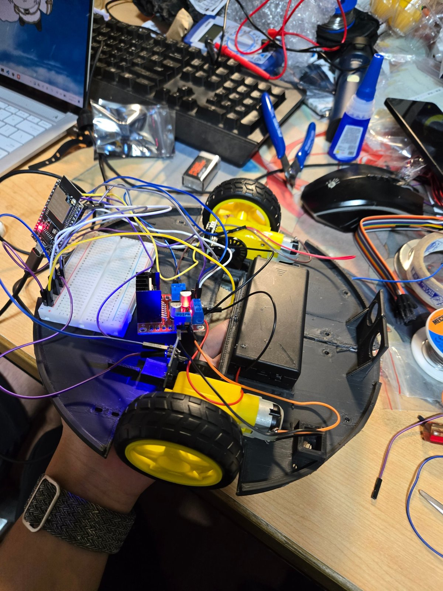
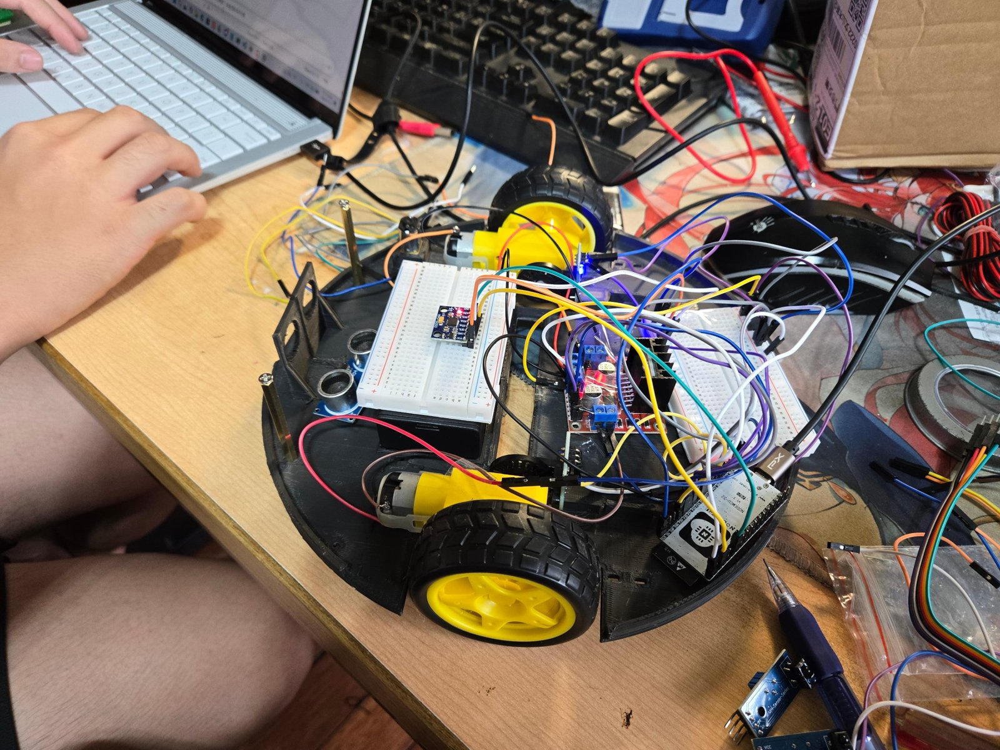
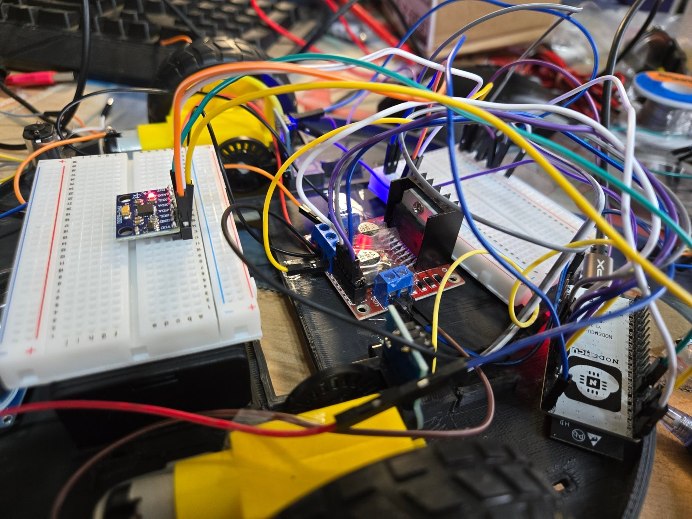
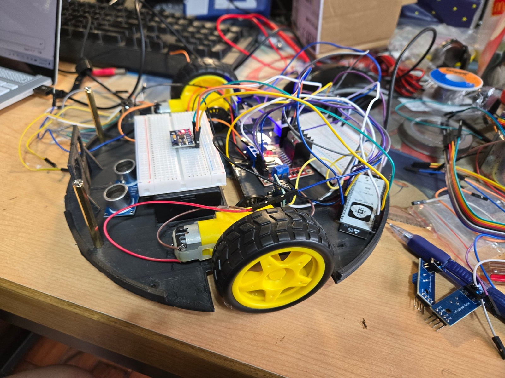

> 專案：ESP32（NodeMCU-32S）掃地機器人 v2（直徑 24 cm 圓形底盤）
> 這天的重點：把 MPU6050 陀螺儀裝上車，並把「轉彎、直走、輪子大小」一項一項校準到準確。

---

## 1. 當天的硬體狀態

下層底盤（3D 列印）已經組好，上面有：兩顆黃色 TT 馬達加編碼器碼盤、L298N 馬達驅動板、
NodeMCU-32S、麵包板、MPU6050 陀螺儀、電池盒，前方裝了 HC-SR04 超音波的支架。
編碼器用 HC-020K（碼盤 20 格）。

**凌晨 02:13**：下層底盤，ESP32 接著 USB 線連到電腦。

**13:04**：整台車的樣子，麵包板上方裝了 MPU6050，線比較多、比較亂。

**13:04**：MPU6050（麵包板上的紫色小板）和 L298N、ESP32 之間的接線特寫。
MPU6050 接 SDA→GPIO 21、SCL→GPIO 22、3.3V。

**13:04**：從側面看，MPU6050 在麵包板上，前方可以看到超音波支架。

---

## 2. 當天做了什麼

### 2-1. MPU6050 陀螺儀上車
- 開機時車子靜止 1 秒，自動量零點（實測零點約 **−0.23 °/s**）。
- 車子停著超過 1 秒就自動重新量零點，避免角度慢慢漂移。
- 正負號自動判斷：第一次原地轉彎，程式會比對陀螺儀轉的方向和指令的方向，
  不一樣就自動翻過來並存起來。實測正負號是 **−1**（晶片方向相反），已自動儲存。

### 2-2. 輪距校準
- 用 40 格模式（碼盤兩個邊緣都算，一圈 40 格）原地轉彎 6 次，
  再用陀螺儀量實際轉了幾度，反推出有效輪距 **199 mm**。

### 2-3. 轉彎改用陀螺儀決定停在哪
- 第一版：轉到陀螺儀說差不多了就放開，再學「放開後還會多轉幾度」（固定度數）。
  22 次轉彎後，90° 收斂到 ±0.5°；但 45° 少轉約 3°、180° 多轉約 2°。
- 原因：放開後多轉的角度其實跟「放開那一刻的轉速」有關，不是固定值。
- 第二版：改成「提前度數 ＝ K × 放開時轉速」，學 K（單位是秒）。
  實車轉了 26 次之後，K 右轉 **0.094 秒**、左轉 **0.079 秒**，
  45°、90°、180° 都在 **±1°** 以內。

### 2-4. 直走鎖方向
- 出發時記下陀螺儀角度，途中歪了就修正左右輪速度（PID：KH、KHI、KHD）。
- 左右輪編碼器同步改成只留比例項（40%），不然積分項會跟陀螺儀「方向不歪」互相拉扯。
- 實車調到 KH 14、KHI 25、KHD 0.7：前進或後退 2 圈停下偏 **±0.9°** 以內；
  關掉鎖方向時偏 −4.7～−7.1°。

### 2-5. 車子歪是車子的問題還是地板的問題？
- 關掉鎖方向，來回各 3 趟共 6 次：**6 次全部往車子左邊偏**。
- 結論：主要是車子（左輪比較吃虧）。地板不平則讓偏差忽大忽小（−3～−20°）。

### 2-6. 自動學習：直走微調與輪子比例
- 微調（前進 +8.1、後退 +4.2 PWM）：鎖方向開著時偏 ±1.2° 內，
  但鎖方向關掉時還是偏 −3.5～+4.7°，沒有改善。
- 原因：編碼器同步堅持「左右格數一樣」，但車子要走直，左輪其實要多轉約 2.3%。
- 改學**輪子比例**（左輪格數 ÷ 右輪格數），實測學到 **1.034**。
  鎖方向關掉時，直走 2 圈偏 +0.3、+0.9、+0.6、−2.1、+0.7、+0.7°，明顯比之前好。

### 2-7. 陀螺儀比例與輪徑校準
- 陀螺儀比例：原地轉 360° 兩次，陀螺儀讀 358.5° 和 359.0°，
  目視實際也差約 1°，所以比例 1.0 是對的，不用改。
- 輪徑：直走 1.4 圈、用 30 cm 的尺量 3 趟，實際 29.6 / 30.0 / 28.65 cm，
  程式算出來是 28.8 / 29.1 / 27.8 cm，差約 2.9%。
  有效輪徑修正為 **66.9 mm**，距離誤差從約 3% 降到接近 0。

---

## 3. 遇到的問題

| 問題 | 原因 / 處理 |
|---|---|
| Arduino IDE 把寫好的新版程式蓋掉了 | IDE 開著檔案時，按編譯或上傳會把 IDE 裡的舊內容存回去。改完檔案要先關掉再重開才燒錄。 |
| 無線燒錄（OTA）顯示 No response from device | 多半是 Windows 防火牆或網路設成「公用網路」，電腦找不到機器人。需要手動改設定，尚未解決。 |

---

## 4. 當天的校準結果總整理

| 項目 | 數值 |
|---|---|
| 有效輪徑 | 66.9 mm |
| 有效輪距 | 199 mm |
| 輪子比例（左格數 ÷ 右格數） | 1.034 |
| 陀螺儀正負號 | −1（已自動儲存） |
| 陀螺儀零點 | 約 −0.23 °/s |
| 陀螺儀比例 | 1.0 |
| 轉彎提前量 K | 右 0.094 秒、左 0.079 秒 |
| 直走鎖方向 | KH 14、KHI 25、KHD 0.7 |
| 轉彎精度 | 45° / 90° / 180° 都在 ±1° |
| 直走精度（鎖方向開） | 2 圈偏 ±0.9° 以內 |

---

## 5. 心得
