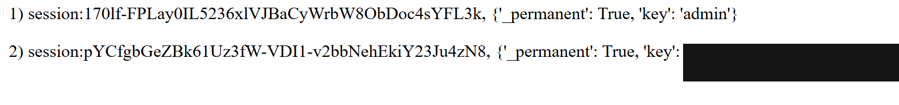

今天在 picoCTF（CyLab Security Academy）練兩題 Web Exploitation，都是登入相關但走完全不同的路。這篇記錄解題過程和背後的漏洞原理。

> 以下都在 picoCTF 官方授權的練習環境進行，flag 和資料都是靶場內建的。這些技術只能用在自己的、或明確授權的系統上。

## 第一題：The New Twitter — Session 劫持

一個社群網站的登入頁。試了 SQL 注入登入繞過，沒成功。讀原始碼發現沒有特別的東西，但頁面給了 **Register** 功能——既然能註冊，那就先註冊一個帳號登入看看。

登入後進到首頁，重點在**留言區**。CTF 的線索常藏在看得到的地方，仔細讀每一則留言：

- 有個使用者留言：「Hey I found a strange page at **/sessions**」
- 另外有個 **Admin** 使用者

目標很明顯：**變成 Admin**。而那則留言直接告訴我下一步去哪。

<!-- 這裡可補一張「首頁留言區」的截圖，顯示提到 /sessions 的那則留言。放到 /assets/images/learning/day6/twitter-hint.png 再把這行註解換成圖片語法。 -->

### 關鍵：session 是什麼

HTTP 本身是「健忘」的（無狀態），每個請求伺服器都當陌生人。那登入一次後，它怎麼記得「還是你」？靠 **session**：

- **session**：伺服器端記著「這人是誰、登入了沒」的紀錄
- **session token**：指向那筆紀錄的隨機號碼牌（放在 cookie 裡）

像「寄放大衣 + 號碼牌」——伺服器只認號碼牌，不認人。所以**偷到別人的 session token 貼上去，就能冒充對方**（session 劫持）。

### 偷 admin 的號碼牌

直接在網址列打 `/sessions` 進去，這頁好心地列出了**所有人的 session token 對應哪個使用者**：

```
1) session:170lf-...FYL3k, {'key': 'admin'}          ← Admin 的！
2) session:pYCfgb...Ju4zN8, {'key': 我的email}
```

接著把自己的 cookie 值（F12 → Application → Cookies）換成 admin 那串，重新整理頁面——伺服器看到 admin 的號碼牌，就把我當成 Admin，flag 出現。


*/sessions 把每個人的 session token 都列出來了，直接拿 admin 那串冒充*

### 漏洞原理

這題其實是兩層失誤疊起來：

1. **`/sessions` 沒做權限檢查**（Broken Access Control，OWASP 排名第 1）——這頁應該只有 admin 能看，卻任何登入者都進得去
2. **它洩漏了所有人的 session token**——session token 等於半個密碼，根本不該顯示出來

真實世界「忘記關掉的 debug / admin 頁面」是滲透最愛找的東西，很多大公司就是這樣被打的。

## 第二題：Crack the Gate 1 — 開發者後門

另一個登入頁，題目說「usual guessing hasn't worked, but it's almost like the developer left a secret way in」——暗示有後門。

SQL 注入試了沒用。改成**仔細讀原始碼**，在 HTML 註解裡發現可疑的一段：

```html
<!-- ABGR: Wnpx - grzcbenel olcnff: hfr urnqre "K-Qri-Npprff: lrf" -->
<!-- Remove before pushing to production! -->
```

第二行「上線前要刪」直接說明這是忘了刪的東西。第一行不是亂碼，是**結構像英文句子**——這是替換式密碼，最常見的是 **ROT13**（每個字母往後移 13 位）。

### 解碼

用 CyberChef（拉 ROT13 操作）解開：

```
NOTE: Jack - temporary bypass: use header "X-Dev-Access: yes"
```

原來有個後門：**只要帶 HTTP header `X-Dev-Access: yes` 就能繞過登入**。

<!-- 這裡可補一張「CyberChef 解 ROT13」的截圖，放到 /assets/images/learning/day6/gate-rot13.png 再把這行註解換成圖片語法。 -->

ROT13 不是加密，是「隱晦」——5 秒就解開，這種藏法完全不安全。

### 讀 JavaScript 找真正的端點

一開始走了彎路——把 header 送到首頁 `/` 沒反應。回頭讀 `<script>` 才發現，登入是 JS 用 `fetch` 在背景發的：

```javascript
fetch('/login', {
    method: 'POST',
    headers: { 'Content-Type': 'application/json' },
    body: JSON.stringify({email, password})
})
.then(r => r.json())
.then(data => { if (data.success) { /* data.flag */ } })
```

所以真正處理登入的是 **POST `/login`**，吃 JSON，flag 在回應的 `data.flag`。後門 header 要送到這裡才有用。

### 送出後門請求

用 curl（或 Burp Repeater）組一個 POST 到 `/login`，帶上後門 header：

```bash
curl -X POST \
  -H "Content-Type: application/json" \
  -H "X-Dev-Access: yes" \
  -d '{"email":"ctf-player@cylabacademy.org","password":"123"}' \
  "http://靶機/login"
```

- `-H "Content-Type: application/json"`：告訴伺服器 body 是 JSON，它才讀得懂
- `-H "X-Dev-Access: yes"`：後門，繞過密碼檢查
- body 裝 email/password，伺服器需要資料才能運作

伺服器看到後門 header → 跳過密碼檢查 → 回傳 `{"success":true,"flag":"..."}`。

### 漏洞原理

這題是好幾個壞習慣的集合：

| 錯誤 | 問題 |
|---|---|
| 留了後門 header | 為了測試方便加的秘密通道，上線該移除 |
| 用 ROT13「藏」起來 | 隱晦式安全（Security through Obscurity）= 假的安全 |
| 寫進前端註解 | 使用者看得到，等於沒藏 |
| 忘記刪 | 工程師自己知道要刪卻忘了，真實世界最常見 |

## 兩題的共同收穫

- **讀完所有原始碼**：HTML 註解 + 全部 `<script>` + Network 分頁。現代網頁很多邏輯在 JS 裡（像第二題的 `/login`），光看表單看不出真相，我就是漏看 JS 繞了遠路。
- **第一個假設常常錯**：兩題我都先試 SQL 注入，都不是。打不通就換角度，別硬鑽。
- **隱晦不等於安全**：ROT13、藏在 `/sessions`、藏在 JS——這些都是假防護，遲早被挖出來。

## 心得

**第一題**可以說我犯蠢了。我不知道這個網站每隔 13 分鐘要重啟一次，所以去打 `/sessions` 的時候連不進去；而且 `/sessions` 這個提示其實也是 AI 給的，我自己沒發現。

**第二題**我想了很久。先考慮 SQL 注入，發現行不通；去檢查原始碼後發現有隱藏的訊息，拿去解碼後發現可以繞過去，我又試了 Burp 去繞繞看，結果成功了。但我並不曉得怎麼打那個請求格式，是 AI 教我的——下次我會先 Google 搜一遍，不要每個都靠 AI。

